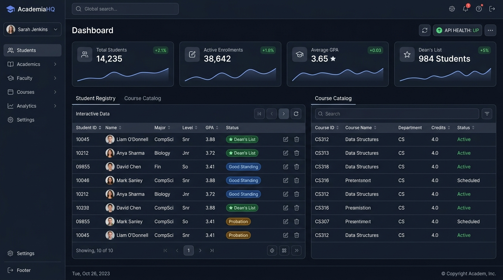
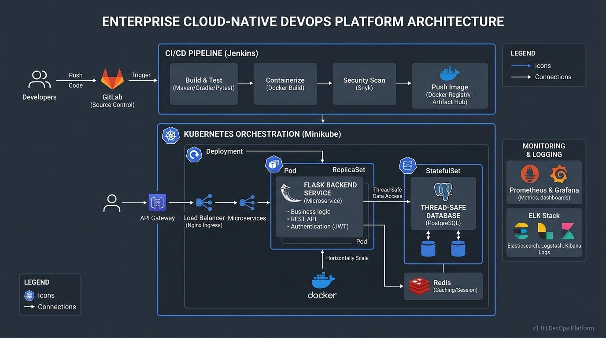

# Enterprise Student Record & Academic Management Platform

[](.github/workflows/ci.yml)
[](reports/test-results.xml)
[](Dockerfile)
[](k8s/)
[](https://www.python.org/)
[](LICENSE)

An enterprise-grade, cloud-native student record and academic grading microservice built with Python, Flask, Pytest, Docker, Jenkins, and Kubernetes (Minikube).

---

## 📸 Platform Preview



---

## 🏛️ System Architecture



The platform is architected according to modern enterprise multi-tier software engineering standards:

```text
student-academic-platform/
├── .github/
│   └── workflows/
│       └── ci.yml                # Automated GitHub Actions CI workflow (Lint, Test, Docker)
├── app/
│   ├── __init__.py               # Flask Application Factory pattern (create_app)
│   ├── routes/
│   │   ├── __init__.py
│   │   ├── api.py                # REST API Endpoints (Health, Students, Courses, Enroll, Grades)
│   │   └── views.py              # Web Dashboard Controller (HTML/Jinja2 view)
│   ├── services/
│   │   ├── __init__.py
│   │   └── student_service.py    # Core Business Logic, Credit Limits & GPA Formula
│   ├── models/
│   │   ├── __init__.py
│   │   ├── student.py            # Student entity schema & validation
│   │   ├── course.py             # Course catalog entity schema & capacity rules
│   │   ├── enrollment.py         # Enrollment transactional record model
│   │   └── grade.py              # Grade/marks evaluation & letter mapping model
│   ├── static/
│   │   └── style.css             # Responsive enterprise dark/light theme CSS
│   └── templates/
│       └── index.html            # Web UI dashboard with live metric cards & forms
├── database/
│   ├── __init__.py
│   └── db.py                     # Thread-safe in-memory database store with seed data
├── docs/
│   └── images/                   # High-resolution architectural diagrams & UI previews
│       ├── architecture-diagram.jpg
│       └── dashboard-preview.jpg
├── tests/
│   ├── __init__.py
│   ├── test_student_service.py   # Unit tests for student registry operations
│   ├── test_course_enrollment.py # Unit tests for course capacity & 18-credit limit rule
│   ├── test_marks_mgmt.py        # Unit tests for marks entry, GPA & standing evaluation
│   └── test_api_endpoints.py     # HTTP integration tests via Flask test_client
├── k8s/
│   ├── deployment.yaml           # Kubernetes Deployment (3 replicas, RollingUpdate, probes)
│   └── service.yaml              # Kubernetes Service (NodePort 30090)
├── Jenkinsfile                   # Declarative Multi-Stage CI/CD Pipeline
├── Dockerfile                    # Multi-layer secure container build recipe
├── .dockerignore                 # Container build exclusions
├── requirements.txt              # Pinned Python package dependencies
├── package.json                  # Convenience CLI runners (npm run dev, test)
├── run.py                        # Production application server entrypoint
├── LICENSE                       # MIT License
├── .gitignore                    # Version control exclusion rules
└── README.md                     # Comprehensive architecture and runbook
```

---

## ⚡ Quick Start & Execution

### Option 1: Native Python (Development)
```bash
# Clone the repository
git clone https://github.com/steel-exe/student-academic-platform.git
cd student-academic-platform

# Create and activate virtual environment
python -m venv .venv
source .venv/bin/activate       # On Windows: .\.venv\Scripts\Activate.ps1

# Install dependencies
pip install -r requirements.txt

# Run application server
python run.py
# Or via npm script runner: npm run dev
```
Open **[http://localhost:5000](http://localhost:5000)** in your browser.

---

### Option 2: Docker Container (Production)
```bash
# Build the Docker image
docker build -t student-academic-platform:v1.0.0 .

# Run the container with port forwarding
docker run -d -p 5000:5000 --name student-container student-academic-platform:v1.0.0

# Verify health status
curl http://localhost:5000/api/health
```

---

### Option 3: Kubernetes (Minikube Orchestration)
```bash
# Point shell to Minikube's Docker daemon
eval $(minikube docker-env)

# Build image inside Minikube
docker build -t student-academic-platform:v1.0.0 .

# Deploy Kubernetes manifests
kubectl apply -f k8s/deployment.yaml
kubectl apply -f k8s/service.yaml

# Verify pods and service
kubectl get pods -l app=student-platform
kubectl get svc student-service
```

---

## 📊 Core Business Rules & Validation

1. **Semester Credit Limit**: A student cannot register for more than **18 credits** in a given semester. Attempting to enroll in excess of 18 credits triggers `ValueError: Semester credit limit exceeded (Max: 18 credits)`.
2. **Duplicate Prevention**: Students cannot enroll in the same course for the same semester more than once.
3. **Course Capacity Governance**: Enrollments are automatically capped by `max_capacity`.
4. **Weighted GPA Calculation**:
   $$\text{GPA} = \frac{\sum (\text{Course Credits} \times \text{Grade Points})}{\sum \text{Total Graded Credits}}$$
5. **Grading Matrix**:
   - 90.0 - 100.0: **Grade A** (4.0 quality points)
   - 80.0 - 89.9: **Grade B** (3.0 quality points)
   - 70.0 - 79.9: **Grade C** (2.0 quality points)
   - 60.0 - 69.9: **Grade D** (1.0 quality point)
   - 0.0 - 59.9: **Grade F** (0.0 quality points)
6. **Academic Standing Evaluation**:
   - $\text{GPA} \ge 3.50$: **Dean's List**
   - $2.00 \le \text{GPA} < 3.50$: **Good Standing**
   - $\text{GPA} < 2.00$: **Academic Probation**

---

## 🔌 REST API Endpoint Reference

| Method | Endpoint | Description | Status Codes |
|---|---|---|---|
| `GET` | `/api/health` | Liveness & Readiness health probe | `200` |
| `GET` | `/api/dashboard` | Aggregated system metrics & stats | `200` |
| `GET` | `/api/students` | List all students or filter with `?q=` | `200` |
| `POST` | `/api/students` | Register a new student | `201`, `400` |
| `GET` | `/api/students/<id>` | Fetch individual student record | `200`, `404` |
| `DELETE` | `/api/students/<id>` | Remove student (fails if active courses) | `200`, `400` |
| `GET` | `/api/students/<id>/transcript` | Generate complete academic transcript | `200`, `404` |
| `GET` | `/api/courses` | List course catalog or filter with `?q=` | `200` |
| `POST` | `/api/courses` | Create a new course entry | `201`, `400` |
| `GET` | `/api/courses/<id>` | Fetch single course metadata | `200`, `404` |
| `POST` | `/api/enroll` | Register student into course (validates credit limit) | `200`, `400` |
| `POST` | `/api/drop` | Drop an active course registration | `200`, `400` |
| `POST` | `/api/grades` | Submit marks (0-100), assign grade, update GPA | `200`, `400` |

---

## 🧪 Automated Testing & Code Quality Gates

The test suite contains **35 tests** across 4 dedicated test modules with **91% overall statement coverage**:

```bash
# Execute Pytest test suites with coverage report & JUnit XML export
pytest -v --cov=app --cov-report=term-missing --junitxml=reports/test-results.xml tests/

# Execute static code analysis syntax gate via Flake8
flake8 app/ database/ --count --select=E9,F63,F7,F82 --show-source --statistics
```

---

## 📜 License
This project is licensed under the MIT License - see the [LICENSE](LICENSE) file for details.
